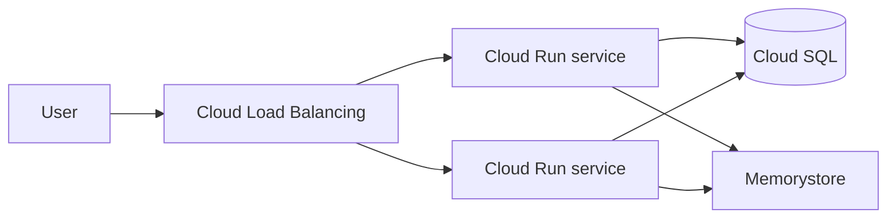

# Sample architecture guide: Deploy a stateless web service

This document is a representative complete architecture guide, written in the Google Cloud Well-Architected Framework style. Use it as a template when writing architecture documentation.

## Overview

This architecture deploys a stateless web service that scales to zero when idle and survives region-level failures. The design follows the Well-Architected Framework principles of simplicity, decoupling, and statelessness.

## Architecture diagram



## Architecture components

| Component | Purpose |
| :--- | :--- |
| Cloud Load Balancing | Distributes traffic across Cloud Run instances and provides a global endpoint. |
| Cloud Run | Runs the stateless container, autoscaling from zero to the configured maximum. |
| Cloud SQL | Stores relational data with automated backups and high availability. |
| Memorystore | Caches session-independent data to reduce database load. |

## Design decisions

| Decision | Chosen | Alternative | Reason |
| :--- | :--- | :--- | :--- |
| Compute | Cloud Run | Compute Engine VM | Managed platform; scales to zero; no infrastructure to maintain. |
| Database | Cloud SQL | Self-managed Postgres | Automated backups and failover; acceptable cost at this scale. |
| Session state | Store in cookies | In-memory sessions | Keeps instances stateless; any instance can serve any request. |

## Before you begin

- A Google Cloud project with billing enabled.
- The `gcloud` CLI installed and authenticated.

## Deploy the service

1. Enable the required APIs.

   ```sh
   gcloud services enable run.googleapis.com sqladmin.googleapis.com
   ```

2. Create the database.

   ```sh
   gcloud sql instances create books-db \
     --database-version=POSTGRES_15 \
     --tier=db-f1-micro
   ```

3. Deploy the container to Cloud Run.

   ```sh
   gcloud run deploy books-api \
     --image us-docker.pkg.dev/cloudrun/container/hello \
     --allow-unauthenticated
   ```

4. Point the load balancer at the Cloud Run service, then verify the endpoint returns `200`.

## Reliability and security

- Define reliability from user-experience goals and set realistic targets, such as 99.9 percent availability.
- Build redundancy across zones by running multiple Cloud Run instances.
- Apply zero trust: require authentication with Identity-Aware Proxy for administrative access.
- Implement shift-left security by scanning container images in the CI pipeline.
- Test recovery by restoring from a Cloud SQL backup in a staging project.

## Cost estimate

| Component | Estimated monthly cost |
| :--- | :--- |
| Cloud Load Balancing | $18.00 |
| Cloud Run | $0.00 at rest; varies with requests |
| Cloud SQL (db-f1-micro) | $7.60 |
| Memorystore (basic) | $9.00 |

## What's next

- [Google Cloud Well-Architected Framework](https://cloud.google.com/architecture/framework) for the full pillar guidance.
- [Reliability pillar](https://cloud.google.com/architecture/framework/reliability) for resilience best practices.
